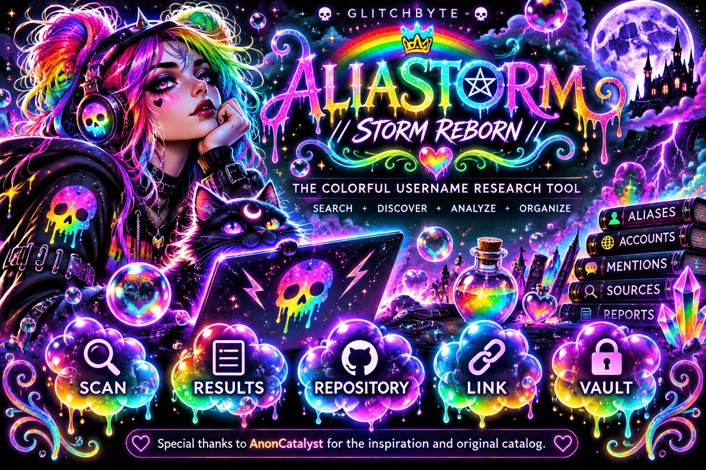
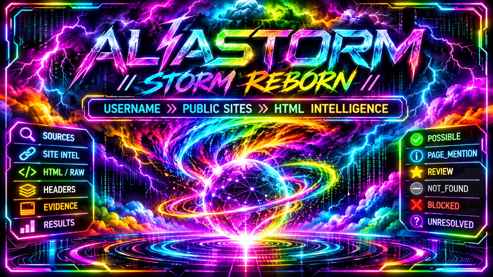
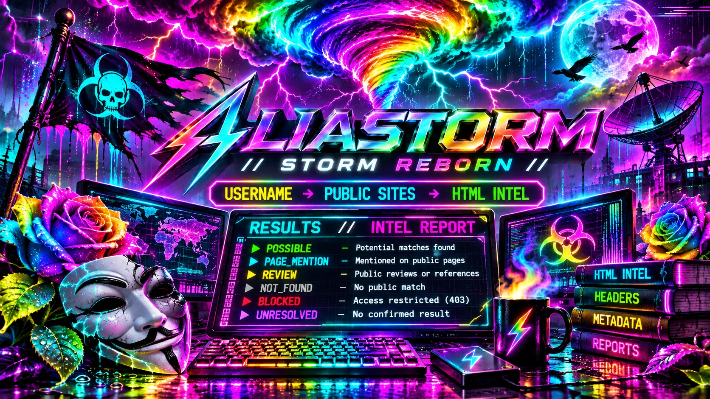

<div align="center">

<a href="https://hellfire13666.github.io/ALIASTORM-STORM-REBORN/"></a>

# 🌈 ALIASTORM // STORM REBORN ⚡

**GLITCHBYTE PHANTOM LABS**

*Username → Public Sites → HTML Intel*

**[🌈 ENTER THE STORM](https://hellfire13666.github.io/ALIASTORM-STORM-REBORN/)** · **[🎨 ART GALLERY](https://hellfire13666.github.io/ALIASTORM-STORM-REBORN/#gallery)** · **[⚡ SOURCE](src/aliastorm.py)**

</div>

A rainbow-colored, terminal-first public username research tool with up to **154 public-source patterns**, local HTML reports, site intelligence, and a private research vault. The terminal prints results; the browser opens only when you explicitly select a saved report.

<div align="center">


</div>

### 💗🫧 ONE PASTE • ONE RAINBOW STORM

**Linux • Git + Python 3 • Copy the entire line into your terminal.** 🌈✨

```bash
cd "$HOME/Downloads" && { [ -f ALIASTORM-STORM-REBORN/RUN-ALIASTORM.sh ] || git clone https://github.com/Hellfire13666/ALIASTORM-STORM-REBORN.git; } && cd ALIASTORM-STORM-REBORN && bash RUN-ALIASTORM.sh --color always
```

💚 **First time:** downloads and opens the tool. **Next time:** opens the existing copy without cloning again. Exiting leaves you *inside* its folder, ready for the simple recipe below. No automatic browser opening.

### 👾 Run a username storm (after opening the tool once)

```bash
bash RUN-ALIASTORM.sh Rosie --color always
```

Change `Rosie` to the public username you want to research. For the menu, use `bash RUN-ALIASTORM.sh --color always` again. **No `python3 aliastorm.py` from Downloads**: the source lives in `src/`. From any folder you can also run `bash "$HOME/Downloads/ALIASTORM-STORM-REBORN/RUN-ALIASTORM.sh" Rosie --color always`.

### 🖥️ INSIDE THE STORM // TOOL LAYOUT

A proper terminal cockpit, not just a static list of links:

| Menu | What opens |
|:---|:---|
| **[1] 🌈 USERNAME STORM** | Enter a public username, choose the full 154-pattern sweep or quick mode, and watch results print in rainbow colors as sources are checked. |
| **[2] 🕸️ SITE INTEL EXTRA** | Investigate one public website's response headers, page metadata, robots.txt, and security-related public signals. |
| **[3] 🧪 OFFLINE DEMO** | Try fictional examples without sending web requests. |
| **[4] 🔮 HTML RESULTS VIEWER** | Select an existing local report and open it in your browser *only if you choose it*. |
| **[0] 🖤 EXIT** | Leave the terminal without opening more windows. |

Every result has its own colorful status, source address, observed HTTP response and available page clues. Optional details include titles, meta descriptions, H1 headings, visible HTML text, raw HTML excerpts and selected response headers.

### 🔮 THE HTML REPORT // PRETTY EVIDENCE, CLEAR DETAILS

Each username run saves **four local reports**: a rainbow-themed **HTML viewer**, structured **JSON**, sortable-in-spreadsheet **CSV**, and plain **TXT**. They're generated on your computer, never uploaded to this website.

The offline HTML viewer wears its own dramatic GlitchByte storm artwork and includes:

- **🌺 Evidence cards** that expand to show page titles, descriptions, headings, canonical links, excerpts, timestamps and source URLs
- **🔎 Local quick search** across domains, titles, URLs and visible report metadata
- **🫧 Six colorful status filters**: POSSIBLE, PAGE_MENTION, REVIEW, NOT_FOUND, BLOCKED and UNRESOLVED
- **⚡ Sorting** by original source order, site name or evidence category
- **💗 Expand/collapse controls** to inspect records without losing the overview

The site you are viewing on GitHub Pages is an **artwork gallery and interactive command preview**. The actual scan runs in your local terminal; clicking around the public gallery does not run a search.

### 💅 THE RAINBOW MOD DECK

**🌈 24-bit RGB terminal** · **🔎 154 public-source patterns** · **🧪 Offline demo** · **🛡️ Conservative redirects + HTTPS-first** · **🔮 Searchable HTML report viewer** · **📜 JSON / CSV / TXT exports** · **🔐 Local vault**

The source, working mods, tests and artwork are here. The public website is the glittery showcase; actual scanning happens on your computer.

### 🔐 Local vault

Research reports stay on your computer inside `local-reports/` (ignored by Git). Optional vault helpers and instructions are in [`src/`](src/PRIVATE-VAULT-README.md). The GitHub Pages gallery is a visual showcase, not a live scanner.

### 💜 Credits

Special thanks to **AnonCatalyst** for inspiration and the original public-site catalog. The full original MIT license remains in [`src/LICENSE-ORIGINAL-ALIASTORM.txt`](src/LICENSE-ORIGINAL-ALIASTORM.txt), with details in [`src/ATTRIBUTION.md`](src/ATTRIBUTION.md).

<sub>A public username match or mention is not proof of identity. Review evidence carefully.</sub>
